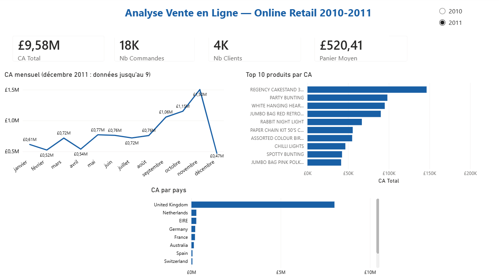

# 🛒 Analyse Vente en Ligne — Dataset Kaggle

## 📌 Contexte

Ce projet analyse la performance commerciale d'un e-commerce B2B britannique
(Online Retail Dataset — UCI Machine Learning Repository) sur la période 2010-2011.
Il simule une mission d'analyse complète : exploration, nettoyage, KPI, segmentation
clients et restitution dans un tableau de bord Power BI interactif.

## 🎯 Objectifs

- Analyser l'évolution du chiffre d'affaires et la saisonnalité des ventes
- Identifier les produits et marchés les plus performants
- Segmenter les clients par valeur (récence, fréquence, montant)
- Valider les KPI Python via des requêtes SQL BigQuery
- Restituer les enseignements dans un tableau de bord Power BI interactif

## 📐 Périmètre d'étude

| Paramètre | Valeur |
|-----------|--------|
| Marché | Royaume-Uni (B2B) |
| Période | 1er décembre 2010 → 9 décembre 2011 |
| Source | Online Retail Dataset — Kaggle / UCI |
| Volume initial | 541 909 transactions |
| Volume après nettoyage | 524 876 transactions |

## 📂 Structure du dépôt

```text
Projet-vente-en-ligne_kaggle/
│
├── data/
│   ├── online_retail_clean.csv       ← Dataset source (Kaggle, séparateur ;)
│   └── online_retail_bigquery.csv    ← Dataset nettoyé, exporté pour BigQuery
│
├── notebooks/
│   └── analyse.ipynb                 ← EDA, nettoyage, analyses, segmentation clients
│
├── sql/                              ← Requêtes BigQuery (KPI et validation)
|
├── powerbi/
│   └── dashboard_kaggle.pbix         ← Dashboard Power BI interactif
│
├── requirements.txt                  ← Librairies Python utilisées
└── README.md                         ← Documentation du projet
```


## 📊 Conventions métier

| Règle | Définition |
|-------|-----------|
| Vente | Ligne avec Quantity > 0 et UnitPrice > 0 |
| Retour | Ligne avec Quantity < 0 |
| Commande annulée | Commande géante annulée quelques minutes après sa saisie → exclue |
| CA | Quantity × UnitPrice (sur les ventes uniquement) |
| Panier moyen | CA ÷ nombre de commandes distinctes |
| Client actif | CustomerID non nul |

## 📈 KPI suivis

| KPI | Définition |
|-----|-----------|
| Chiffre d'affaires | Somme de Quantity × UnitPrice |
| Nb commandes | Nombre de InvoiceNo distincts |
| Nb clients | Nombre de CustomerID distincts |
| Panier moyen | CA ÷ Nb commandes |
| Score de valeur client | Score Récence + Fréquence + Montant (1 à 4 par dimension) |

## 📊 Aperçu du tableau de bord



## 📊 Résultats clés

### 💰 Chiffre d'affaires
- **CA total** : £10,396,458
- **Meilleur mois** : Novembre 2011 — £1,503,867
- **Heure de pointe** : 12h → clientèle B2B confirmée

### 🛍️ Produits
- **Top produit CA** : REGENCY CAKESTAND 3 TIER — £174,157
- **Top produit volume** : WORLD WAR 2 GLIDERS ASSTD DESIGNS — 54,951 unités
- **Produit le plus cher** : PICNIC BASKET WICKER 60 PIECES — £649.50 (prix unitaire moyen)

### 👤 Clients
- **4 334 clients identifiés** segmentés
- **Champions** : 29 % des clients génèrent £6,528,099 (76,8 % du CA des clients identifiés)
- **Concentration du CA** : les 20 % meilleurs clients réalisent 73,9 % du CA, proche de la règle des 80/20

### 🌍 Géographie
- **Royaume-Uni** : marché dominant
- **Netherlands** : n°1 international, panier moyen £3,053
- **Germany & France** : plus grand nombre de clients internationaux

## 🔧 Décisions techniques

**Nettoyage des données :**
Suppression des doublons (5 268 lignes), des retours (Quantity < 0),
des prix aberrants (UnitPrice ≤ 0) et des descriptions manquantes.
Les CustomerID manquants (~25%) ont été conservés avec un flag `ClientConnu`
pour ne pas fausser le CA total.

**Contrôles qualité et corrections :**
- **Dates** : le fichier source mélange plusieurs écritures de dates au format américain
  (ex. « 1/18/11 » et « 12/09/2011 »). Une première lecture inversait jour et mois
  sur les dates ambiguës. Correction : lecture mois en premier (`dayfirst=False`),
  vérifiée sur la période couverte (1er décembre 2010 → 9 décembre 2011).
- **Commandes fantômes** : deux commandes géantes (74 215 et 80 995 unités) ont été
  annulées quelques minutes après leur saisie. Supprimer uniquement les lignes d'annulation
  laissait la commande d'origine dans les ventes. Ces deux commandes ont été exclues,
  soit £245,653 de CA qui n'a jamais été réalisé.

**Segmentation clients :**
Découpage en quartiles (1 à 4) sur trois dimensions : récence, fréquence et montant.
Score global → 5 segments de Champion à Inactif.

**Validation BigQuery :**
Les KPI calculés en Python ont été recalculés en SQL BigQuery : nombre de lignes,
CA total et CA de novembre 2011 identiques à l'unité près (écart nul).
Un premier import ignorait une ligne (facture « A563185 », 11 062 £) car BigQuery
avait deviné un type numérique pour InvoiceNo : le schéma est désormais défini à la main.

**Dashboard Power BI :**
Modèle avec table `Dim_Date` reliée à la table de faits `Online_Retail`.
Mesures DAX pour CA N-1 et évolutions en %.
Filtre Année interactif (2010 / 2011).

## 💡 Principaux enseignements

- L'activité accélère nettement à partir de septembre 2011 et culmine en novembre.
- **Novembre 2011 concentre 14,5 % du CA de la période** — saisonnalité pré-fêtes très marquée.
- **29 % des clients (Champions) génèrent 76,8 % du CA des clients identifiés** — risque de concentration élevé.
- Les **Pays-Bas** sont le marché international le plus rentable malgré un faible volume de clients.
- Le **panier moyen néerlandais (£3,053)** est le plus élevé des marchés internationaux.
- Les clients commandent **en semaine, avec un pic en fin de matinée** → comportement B2B confirmé.
- Décembre 2011 n'est couvert que jusqu'au 9 : sa baisse apparente ne reflète pas une baisse des ventes.

## 🛠️ Stack technique

| Outil | Usage |
|-------|-------|
| Python 3.14 | Langage principal |
| Pandas | Manipulation des données |
| NumPy | Calculs numériques |
| Matplotlib / Seaborn | Visualisations |
| BigQuery (Google Cloud) | Requêtes SQL de validation |
| Power BI | Dashboard interactif |
| Git / GitHub | Versioning |

## ⚙️ Installation et reproduction

**Prérequis :**
- Python 3.10+
- VS Code avec extension Jupyter
- Power BI Desktop
- Compte Google Cloud (BigQuery)

```bash
# Cloner le dépôt
git clone https://github.com/Fatima-Zahra37/Projet-vente-en-ligne_kaggle.git

# Créer et activer l'environnement virtuel
python -m venv venv
venv\Scripts\activate

# Installer les dépendances
pip install -r requirements.txt
```

**Étapes de reproduction :**
1. Placer le fichier CSV dans `data/`
2. Exécuter `notebooks/analyse.ipynb` pour l'analyse complète
3. Importer `data/online_retail_bigquery.csv` dans BigQuery
4. Exécuter les requêtes SQL dans BigQuery
5. Ouvrir `powerbi/dashboard_kaggle.pbix` avec Power BI Desktop

## 📁 Source des données

- **Dataset** : Online Retail Dataset
- **Source** : [Kaggle](https://www.kaggle.com/)
- **Origine** : UCI Machine Learning Repository
- **Période** : 1er décembre 2010 — 9 décembre 2011
- **Volume** : 541,909 transactions initiales → 524,876 après nettoyage

---

## 👩‍💻 Auteure

**Fatima-Zahra FRINDOU** — Data Analyst
[GitHub](https://github.com/Fatima-Zahra37)
